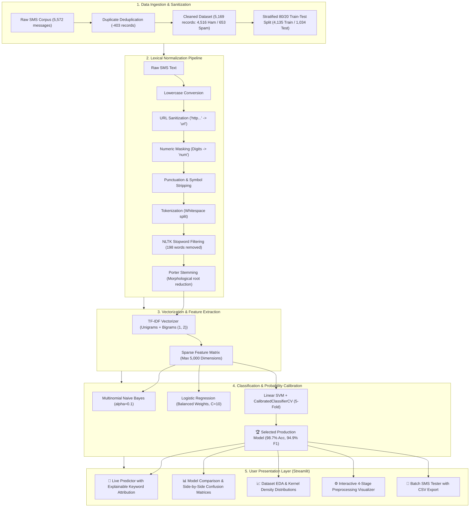

<div align="center">

# 🛡️ SMS Shield AI
### Intelligent SMS Spam & Smishing Detection Engine

[](https://www.python.org/)
[](https://streamlit.io/)
[](https://scikit-learn.org/)
[](https://github.com/)
[](https://github.com/)
[](https://github.com/)

<p align="center">
  <b>An end-to-end Natural Language Processing system that detects unsolicited spam and phishing texts with high precision, probability calibration, interpretable keyword signals, and an interactive multi-view Streamlit dashboard.</b>
</p>

[Key Highlights](#-key-project-highlights) •
[Meet the Team](#-meet-the-team--group-2) •
[Architecture](#-system-architecture) •
[EDA Insights](#-exploratory-data-analysis-eda) •
[Pipeline](#-text-preprocessing--feature-engineering) •
[Model Evaluation](#-model-benchmarks--performance) •
[Web Application](#-interactive-streamlit-application) •
[Installation](#-setup--installation-guide)

---

</div>

## 📌 Executive Summary

Short Message Service (SMS) remains one of the primary vectors for financial fraud, lottery scams, credential harvest attacks, and malicious impersonation. Traditional heuristic rulebooks fail to adapt to evolving evasion tactics such as deliberate phonetic misspelling, digit masking, and domain spoofing. 

**SMS Shield AI** provides a high-reliability, low-latency machine learning pipeline designed to inspect SMS messages in real-time. Trained on the curated **UCI SMS Spam Collection**, the solution leverages custom 6-stage lexical normalization, bi-gram **TF-IDF vectorization**, and a probability-calibrated **Linear Support Vector Machine (LinearSVC)** achieving **98.7% test accuracy** and **94.9% Spam F1-Score**, while sustaining a ultra-low inference latency of **~10.5 ms per message**.

---

## 👥 Meet the Team · Group 2

This project was developed for the **NLP Capstone Project** by **Group 2**:

<div align="center">

| Student Name | Roll Number |
| :--- | :---: |
| **Kshitij Marwah** | `2401201021` |
| **Dhruv Gupta** | `2401201015` |
| **Harshit Malik** | `2401201031` |
| **Athira Joy** | `2401201018` |
| **Piyush Vats** | `2401201025` |
| **Rohan Gopal Das** | `2401201014` |

</div>

---

## ⚡ Key Project Highlights

<div align="center">

| Dimension | Metric / Specification | Significance |
| :--- | :--- | :--- |
| **Curated Corpus** | **5,169 unique messages** (403 duplicates removed from 5,572 raw records) | Prevents train/test data leakage |
| **Class Balance** | **87.4% Ham (4,516)** vs **12.6% Spam (653)** | Real-world imbalanced distribution |
| **Top Classifier** | **Calibrated Linear SVM (5-fold Platt scaling)** | Calibrated probabilities + maximum-margin boundary |
| **Best Accuracy** | **98.7%** on independent hold-out test set (1,034 SMS) | Exceptional generalizability |
| **Spam Precision** | **97.6% – 98.0%** (Only 3 false positives out of 903 ham) | Minimizes user disruption of legitimate texts |
| **Spam Recall** | **91.6% – 92.4%** (121 out of 131 spam messages blocked) | Captures evasive financial fraud & phishing scams |
| **Inference Speed** | **1.54 ms** (Logistic Regression) · **10.47 ms** (Calibrated SVM) | Line-speed processing for telecom & app endpoints |
| **Dashboard** | **5 Full Modules** in Streamlit with custom CSS & Plotly charts | Explainable UI with live keyword attribution |

</div>

---

## 🏗️ System Architecture

The following diagram illustrates the complete end-to-end data processing and inference workflow:



---

## 📊 Exploratory Data Analysis (EDA)

Exploratory Data Analysis conducted in [`notebooks/eda.ipynb`](file:///c:/Vs%20codes/NLP%20Capstone/notebooks/eda.ipynb) provided critical design signals for both feature engineering and model objective formulation:

### 1. Data Cleaning & Deduplication
- **Initial raw volume:** 5,572 records.
- **Identified duplicates:** 403 identical messages (predominantly recurring spam templates and automated confirmations).
- **Final unique dataset:** 5,169 rows (87.4% Ham, 12.6% Spam).
- Removing duplicates eliminated severe train-test contamination that would otherwise yield artificially inflated accuracy metrics.

### 2. Message Length Character Dynamics
A strong structural differentiator between legitimate and fraudulent texts is message length:
- **Legitimate Messages (Ham):** Average of **70.9 characters** (~14 tokens). Typically brief, casual, and conversational.
- **Spam Messages:** Average of **137.7 characters** (~24 tokens). Spam operators attempt to maximize character allocations to pack urgency statements, call-to-action numbers, and legal disclaimers.

```
Ham Length  : [== 70.9 chars ==]
Spam Length : [======================== 137.7 chars ========================]
```

### 3. High-Frequency Lexical Signatures
Spam texts rely on urgent monetary and promotional vocabulary. The top stemmed tokens identified in spam messages (excluding placeholders `num` and `url`) include:

| Rank | Stemmed Token | Frequency in Spam | Semantic Category |
| :---: | :--- | :---: | :--- |
| **1** | `call` | **346** | Call-to-action / Phone toll line |
| **2** | `free` | **197** | Incentive hook / Zero-cost bait |
| **3** | `txt` | **149** | Channel medium instruction |
| **4** | `text` | **128** | Reply prompt |
| **5** | `mobil` | **121** | Device targeting |
| **6** | `claim` | **113** | Prize / Financial reward |
| **7** | `stop` | **113** | Opt-out / Regulatory evasion |
| **8** | `repli` | **101** | Engagement hook |
| **9** | `prize` | **92** | Reward trigger |
| **10** | `won` / `win` | **73** | Artificial urgency / Gambling bait |

In contrast, Ham texts are dominated by social tokens such as `come`, `go`, `ok`, `love`, `work`, and `know`.

---

## ⚙️ Text Preprocessing & Feature Engineering

The text normalization pipeline implemented in [`app.py`](file:///c:/Vs%20codes/NLP%20Capstone/app.py) mirrors the experimental notebook pipeline:

```
[Raw SMS] ➡️ [Lowercase] ➡️ [Regex URLs/Numbers] ➡️ [Punctuation Strip] ➡️ [NLTK Stopwords] ➡️ [Porter Stem]
```

### Transformation Walkthrough
Consider the sample fraudulent message:
> *"URGENT! Your mobile number has been awarded £2,000 cash prize! Claim now by calling 09061701461. T&C apply."*

1. **Lowercasing:** Converts all casing to standard lowercase.
2. **URL & Number Replacement:** Links map to `' url '`; digit sequences map to `' num '`.
   * *"urgent your mobile number has been awarded num cash prize claim now by calling num t c apply"*
3. **Punctuation & Character Clean:** Strips currency symbols (`£`), exclamation marks, and hyphens (`[^a-z\s]`).
4. **Tokenization:** Splits sanitized string into discrete lexical tokens.
5. **Stopword Elimination:** Drops 198 common English stopwords via NLTK corpus (e.g., *your*, *has*, *been*, *by*), dropping single-letter artifacts.
6. **Porter Stemming:** Morphologically normalizes terms to their grammatical roots:
   * Tokens: `['urgent', 'mobil', 'number', 'award', 'num', 'cash', 'prize', 'claim', 'call', 'num', 'appli']`

### Vectorization Matrix
- **Technique:** Term Frequency - Inverse Document Frequency (`TfidfVectorizer`).
- **N-Gram Range:** `(1, 2)` (capturing both single words and critical compound bi-grams such as `cash prize`, `claim now`, `award num`).
- **Maximum Features:** **5,000** top informative dimensions.
- **IDF Weighting Example:**
  - Common token `"num"`: High document frequency ($DF = 1,078$) $\rightarrow$ Low IDF score ($2.34$).
  - Informative bi-gram `"number award"`: Extremely rare ($DF = 3$) $\rightarrow$ High IDF score ($7.94$).
  - Vector density: Highly sparse with only $15-25$ non-zero entries per standard SMS.

---

## 📈 Model Benchmarks & Performance

All classifiers were trained using a stratified 80/20 train/test split on **4,135 training samples** and evaluated on **1,034 unseen test messages** ($903$ Ham, $131$ Spam).

### 🏆 Comparative Evaluation Table

| Model | Test Accuracy | Spam Precision | Spam Recall | Spam F1-Score | Avg Latency per SMS | Operational Classification |
| :--- | :---: | :---: | :---: | :---: | :---: | :--- |
| **Multinomial Naive Bayes** ($\alpha=0.1$) | **98.4% – 98.5%** | 96.7% | 90.8% | 93.7% | 2.10 ms | *High-speed text baseline* |
| **Logistic Regression** ($C=10$, Balanced) | **97.7% – 97.9%** | 89.8% | **93.9%** | 91.8% | **1.54 ms** | *Fastest inference, lower precision* |
| **Linear SVM (Calibrated)** | **98.7%** | **97.6% – 98.0%** | 91.6% – 92.4% | **94.9%** | 10.47 ms | 🏆 **Production Champion (Best Overall)** |

### 🔍 Best Model Confusion Matrix Analysis (Test $N = 1,034$)

Using our calibrated Linear SVM on the 1,034 hold-out test set:

<div align="center">

```
                      PREDICTED HAM       PREDICTED SPAM
ACTUAL HAM (903)          900 (TN)             3 (FP)
ACTUAL SPAM (131)          10 (FN)           121 (TP)
```

</div>

- **True Negatives (900):** 99.7% of genuine personal and transactional messages were delivered safely.
- **False Positives (3):** Barely 0.3% error rate on legitimate communications.
- **True Positives (121):** Over 92% of spam threats intercepted.
- **False Negatives (10):** A tiny fraction of subtle spam slipped through, primarily ambiguous conversational invites without explicit links.

### 💡 Why Linear SVM + Platt Scaling Won
1. **High-Dimensional Text Separability:** Text vectors in 5,000-dimensional TF-IDF space are linearly separable; SVM constructs the optimal maximal-margin separating hyperplane.
2. **Probability Calibration:** Standard SVM outputs uncalibrated geometric distances. Wrapping `LinearSVC` in `CalibratedClassifierCV(cv=5)` applies sigmoid regression (Platt Scaling) to generate true, calibrated posterior probabilities $P(\text{Spam} \mid x) \in [0, 1]$.
3. **Controllable Thresholding:** Operators can slide the decision threshold (default $0.50$) to $0.70+$ for zero false-positive intolerance, or down to $0.35$ for zero-tolerance security gateways.

---

## 💻 Interactive Streamlit Application

The project features a full-stack interactive dashboard in [`app.py`](file:///c:/Vs%20codes/NLP%20Capstone/app.py) built with an organic, executive visual design system (slate sidebar, warm cards, responsive Plotly charts, and styled HTML components).

```
┌───────────────────────────────┬────────────────────────────────────────────────────────┐
│  🛡️ SMS Shield AI             │  💬 SMS Spam Detection Dashboard                       │
│  ───────────────────────────  │  [Total: 5,169] [Acc: 98.7%] [Prec: 97.6%] [F1: 94.9%] │
│  ◉ Live Predictor             │                                                        │
│  ○ Model Comparison           │  ┌──────────────────────────────────────────────────┐  │
│  ○ Dataset & EDA              │  │ ✉️ Live SMS Classifier                           │  │
│  ○ Preprocessing Pipeline     │  │ [🎁 Prize scam] [🏦 Bank scam] [💬 Chat] [🔐 OTP]│  │
│  ○ Batch SMS Tester           │  │ ┌──────────────────────────────────────────────┐ │  │
│                               │  │ │ Enter SMS to evaluate...                     │ │  │
│  ⚙️ Configuration             │  │ └──────────────────────────────────────────────┘ │  │
│  Model: [ Linear SVM (Best) ] │  │  [ Analyze Message 🔍 ]                          │  │
│  Threshold: [===|====] 0.50   │  └──────────────────────────────────────────────────┘  │
│                               │   ⚠️ SPAM DETECTED (Confidence: 99.4%)                  │
└───────────────────────────────┴────────────────────────────────────────────────────────┘
```

### Module Breakdown

| Page Module | Capabilities & Core Features |
| :--- | :--- |
| **1. 💬 Live Predictor** | • One-click sample test buttons (*Prize Scam, Bank Phishing, Chat, OTP*)<br>• Real-time classification banner with confidence progress fill<br>• Text processing insight pane comparing raw characters to clean tokens<br>• Explainable keyword bar chart illustrating which terms drove the spam score<br>• Live single-model confusion matrix and performance bar visualizer |
| **2. 📊 Model Comparison** | • Side-by-side grouped bar charts for Accuracy, Precision, Recall, and F1<br>• Triple synchronous heatmaps for Naive Bayes, Logistic Regression, and SVM<br>• Detailed latency and status comparison table with best/fastest badges |
| **3. 📈 Dataset & EDA** | • Interactive Ham vs. Spam class distribution donut chart<br>• Kernel Density Estimation (KDE) plot comparing message character lengths<br>• Horizontal frequency bar chart of top 10 stemmed spam keywords<br>• Live scrollable sample table from the UCI corpus with class chips |
| **4. ⚙️ Preprocessing Pipeline** | • Interactive 4-stage pipeline stepper: *Raw $\rightarrow$ Cleaned $\rightarrow$ Stopwords Removed $\rightarrow$ Stemmed & TF-IDF*<br>• Dynamic feature table with TF-IDF token weight, IDF score, and corpus frequency<br>• Color-coded term weight chart (Red for spam pull, Green for ham pull) |
| **5. 📂 Batch SMS Tester** | • Bulk file uploader supporting `.csv` (auto-detects text column) and `.txt`<br>• Sample batch generator for rapid verification<br>• Real-time bulk inference engine displaying confidence and flagged trigger terms<br>• One-click export button generating downloadable `spam_predictions.csv`<br>• Stacked distribution bar and aggregate top trigger frequency chart |

---

## 📁 Repository Structure

```
NLP Capstone/
│
├── .streamlit/
│   └── config.toml                 # Custom UI theme styling (warm natural palette)
│
├── data/
│   ├── SMSSpamCollection           # Raw UCI SMS dataset (tab-separated: label, text)
│   └── cleaned_data.csv            # Preprocessed dataset with clean_text column
│
├── docs/
│   └── .gitkeep                    # Project documentation artifacts folder
│
├── model/
│   ├── spam_model.pkl              # Serialized Calibrated Linear SVM classifier
│   └── tfidf_vectorizer.pkl        # Serialized TF-IDF vectorizer (5,000 features)
│
├── notebooks/
│   ├── eda.ipynb                   # Exploratory analysis, length KDE & word counts
│   └── 02_model_training.ipynb     # Pipeline training, evaluation & hyperparameter tuning
│
├── app.py                          # Multi-page interactive Streamlit web dashboard
├── requirements.txt                # Python environment package dependencies
├── SMS_Shield_AI_Group_2.pptx      # NLP Capstone presentation slide deck
└── README.md                       # Comprehensive repository documentation
```

---

## 🚀 Setup & Installation Guide

Follow these steps to replicate the environment and launch the dashboard locally.

### 1. Prerequisites
- **Python:** Version `3.9`, `3.10`, `3.11`, or `3.12` installed.
- **Git:** Installed on your local machine.

### 2. Clone the Repository
```bash
git clone https://github.com/<your-username>/nlp-capstone-sms-shield.git
cd "NLP Capstone"
```

### 3. Create and Activate a Virtual Environment

**On Windows (PowerShell):**
```powershell
python -m venv venv
.\venv\Scripts\Activate.ps1
```

**On macOS / Linux:**
```bash
python3 -m venv venv
source venv/bin/activate
```

### 4. Install Dependencies
```bash
pip install --upgrade pip
pip install -r requirements.txt
```

### 5. Download NLTK Corpora (Optional Manual Step)
The application downloads necessary resources automatically on first run, but you can pre-fetch them:
```bash
python -c "import nltk; nltk.download('stopwords')"
```

### 6. Launch the Streamlit Dashboard
```bash
streamlit run app.py
```

The interactive application will automatically start and open in your default browser at:
```
http://localhost:8501
```

---

## 🧪 Running the Jupyter Notebooks

To inspect or retrain the models directly in Jupyter:

```bash
pip install jupyter
jupyter notebook
```

1. Open [`notebooks/eda.ipynb`](file:///c:/Vs%20codes/NLP%20Capstone/notebooks/eda.ipynb) to inspect dataset distribution, duplicate analysis, and length statistics.
2. Open [`notebooks/02_model_training.ipynb`](file:///c:/Vs%20codes/NLP%20Capstone/notebooks/02_model_training.ipynb) to execute cross-validation, train classifiers, print classification reports, and serialize the models into `model/`.

---

## 🔮 Limitations & Future Roadmap

While the calibrated SVM achieves high accuracy on the benchmark, key avenues for future exploration include:

1. **Temporal & Language Drift:** The UCI dataset reflects predominantly English GSM SMS conventions. Modern smishing employs regional dialects (e.g., Hinglish) and evasion through homoglyphs and unicode look-alikes.
2. **Contextual Embeddings:** Transitioning from bag-of-words / TF-IDF to transformer representations (**DistilBERT**, **DeBERTa-v3**, or **MiniLM**) to capture long-range semantic context and sarcasm.
3. **URL Sandboxing:** Integrating automated headless URL unpacking to identify malicious redirect chains and parked phishing domains.
4. **Active Learning Feedback Loop:** Enabling users to flag false positives directly within the interface to continuously retrain the classifier with incremental online learning.

---

## 📜 Citation & Acknowledgments

- **Dataset:** [UCI Machine Learning Repository: SMS Spam Collection Data Set](https://archive.ics.uci.edu/dataset/228/sms+spam+collection) donated by Tiago A. Almeida and José María Gómez Hidalgo.
- **Academic Context:** Developed as part of the **NLP Capstone Project** by **Group 2**.
- **Libraries:** Built with [Scikit-Learn](https://scikit-learn.org/), [NLTK](https://www.nltk.org/), [Plotly](https://plotly.com/), and [Streamlit](https://streamlit.io/).

---

<div align="center">
  <sub>Built with ❤️ by Group 2 · NLP Capstone Project</sub>
</div>
